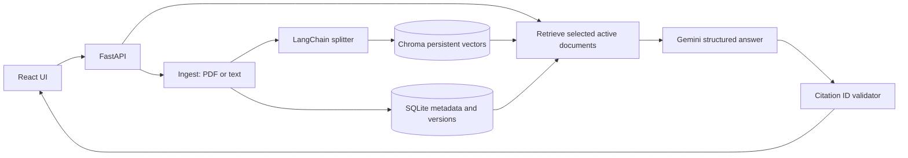

# Architecture and evaluation notes

## Why this change?

The original app embedded the entire pasted document on **every** question and returned excerpts without persistent document IDs or page references. This upgrade makes ingestion and query processing separate operations.

**Use case:** an employee compares the current travel policy with a vendor contract and asks what approval or cancellation conditions are documented. The answer includes document name and page, and is flagged for review if citations are missing.

**Boundaries:** Retrieval runs only over active, selected document IDs. New versions of a document title deactivate older versions. Source references are checked against retrieved chunks, but *citation validation is not factual entailment validation.* The LLM's text should not be treated as legal advice.

## What to measure

Create an independently labeled set (e.g. 40 questions from 4 fictional policy and contract documents, including 10 unanswerable questions) and compare:

| Approach | Recall@5 | Citation validity | Answer correctness | Abstention accuracy | p95 latency |
| --- | --- | --- | --- | --- | --- |
| Original per-query embeddings | Pending | Pending | Pending | Pending | Pending |
| Persistent Chroma dense retrieval | Pending | Pending | Pending | Pending | Pending |
| Keyword + vector hybrid (future) | Pending | Pending | Pending | Pending | Pending |

Measure latency for *ingestion* and *question answering* separately. Do not present LLM-reported `needs_review` as calibrated confidence. Check source claim support manually on a blind subset.

## Security and deployment limitations

- **Single-user local prototype:** No multi-tenant authentication or access controls. Bind to localhost by default.
- Documents and query logs are persisted locally, unencrypted. Do not upload confidential contracts to the demo without appropriate protections.
- Gemini embeddings and generation send source text to Google. For confidential workloads, use a vetted local model or approved cloud configuration.
- Treat document text as untrusted. Prompt-injection resistance is not guaranteed.
- Scanned PDFs need OCR and are not supported by the plain text extractor.
- Write a migration/re-index strategy before changing embedding models or vector dimensions.
