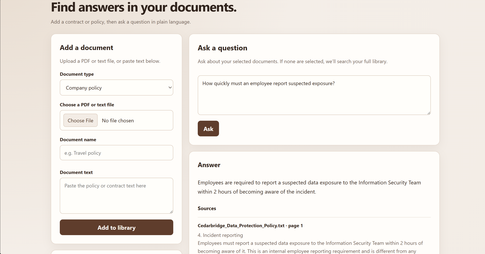

# Contract & Policy Intelligence Assistant

A local-first assistant for searching contracts and company policies. Add documents once, ask questions in plain language, and review answers alongside cited passages.



Built with React and Vite, FastAPI, LangChain, Chroma, SQLite, and Google Gemini.

## Features

- Upload PDF or TXT files, or paste document text. Scanned PDFs are not supported.
- Keep document metadata and versions in SQLite, with persistent vector search in Chroma.
- Search the full library or select specific current documents.
- Review answers with source excerpts, document names, and page numbers. Unsupported or conflicting evidence is flagged for review.
- Replacing a document with new content creates a new version; older versions are excluded from current searches.

## Run locally (Windows PowerShell)

Requires Python 3.11+ and Node.js. From the project root:

```powershell
python -m venv .venv
.\.venv\Scripts\Activate.ps1
python -m pip install -r requirements.txt
$env:GEMINI_API_KEY = "YOUR_GEMINI_API_KEY"
python -m uvicorn app:app --app-dir backend --reload --host 127.0.0.1 --port 8001
```

The backend also reads `GEMINI_API_KEY` from a project-root `.env` file. In a second terminal:

```powershell
cd doc-qa-ui
npm ci
npm run dev
```

Open the URL printed by Vite (usually `http://localhost:5173`). The API is at `http://127.0.0.1:8001`; interactive API documentation is at `http://127.0.0.1:8001/docs`.

Local data is stored in `.local_data` by default; set `RAG_DATA_DIR` to use another location. `GEMINI_CHAT_MODEL` and `GEMINI_EMBED_MODEL` can override the default Gemini models.

## API

- `GET /health`
- `GET /documents` (current versions) or `GET /documents?all_versions=true`
- `POST /documents/upload` (PDF/TXT) or `POST /documents/text`
- `POST /ask` with a question and optional document IDs
- `DELETE /documents/{id}`

## Tests

Run the offline backend tests:

```powershell
cd backend
python -m unittest discover -s test -v
```

The tests use fake model and vector components; they do not cover live Gemini responses or real Chroma indexing.

## Limitations

This is a single-user local app, not a production or multi-user service. It has no authentication, and local data is not encrypted. Document text is sent to Google Gemini for embeddings and answers. Do not upload sensitive files unless you are authorized to share them. AI answers can be wrong and are not legal advice.

See [Docs/architecture.md](Docs/architecture.md) for the architecture and evaluation notes.
